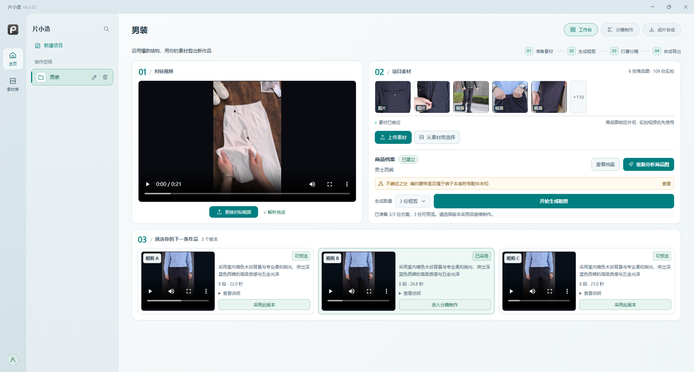
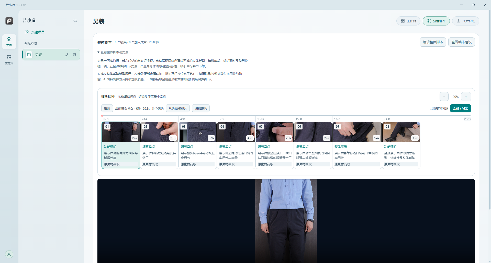
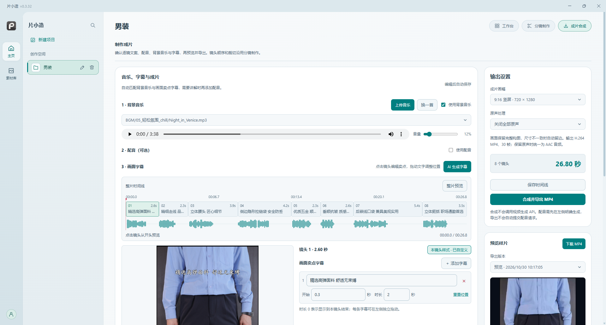
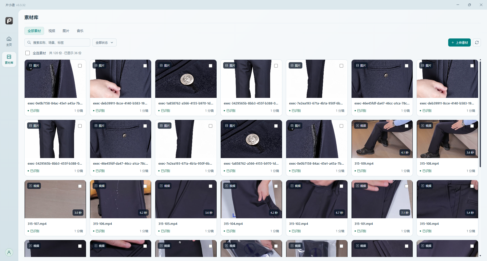
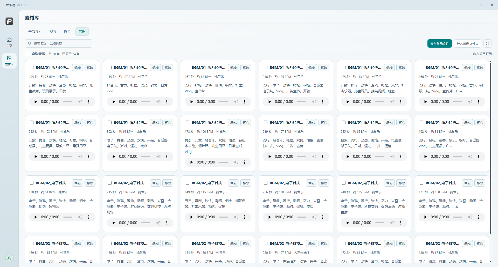

  

<h1 align="center">片小造</h1>

<strong>参考爆款结构，用自己的素材，做出多版电商视频。</strong>

对标拆解 · 素材管理 · 多版本粗剪 · 分镜编辑 · 配音字幕 · 成片导出

  <a href="https://pianxiaozao.cc/">官方网站</a> ·
  <a href="https://github.com/zlqcoder/pianxiaozao-releases/releases/latest">下载客户端</a> ·
  <a href="#界面预览">界面预览</a> ·
  <a href="#快速上手">快速上手</a> ·
  <a href="https://github.com/zlqcoder/pianxiaozao-releases/releases">版本记录</a>

## 片小造是做什么的？

片小造是一款面向**电商商家、带货创作者和短视频运营团队**的桌面视频制作工具，帮助你把分散的商品图片、实拍视频和背景音乐，整理成可以预览、修改和导出的商品短视频。

上传一条对标视频，添加自己的商品图和实拍素材，片小造会分析对标的镜头结构与节奏，从素材中匹配合适的画面，生成多份粗剪方案。选择喜欢的版本后，可以继续调整分镜、补齐镜头、添加卖点字幕、配音和背景音乐，最后导出 MP4。

**优先使用自己的实拍素材，需要时再用 AI 补充镜头。** 从参考到成片，保留人工挑选与编辑的空间，让已有素材更容易被复用。

> 本仓库用于发布片小造桌面版安装包、应用更新文件与版本说明，不包含软件源码。首次使用需要激活码；云端 AI 功能需要联网，并按授权与可用点数使用。

## 适合哪些场景？

- **商品展示与卖点视频**：把外观、细节、功能演示等实拍片段，编排为一条完整的商品短视频。
- **参考视频改编**：参考同类视频的叙事结构和镜头节奏，使用自己的商品与素材重新制作。
- **多版本内容尝试**：用同一批素材生成多份粗剪，比较不同画面组合，再选取合适的版本继续打磨。
- **日常素材复用**：将图片、视频和音乐集中管理，在不同项目中查找、挑选和复用，减少重复整理。

## 主要功能

| 功能 | 可以做什么 |
| --- | --- |
| 对标视频拆解 | 分析参考视频的画面与镜头结构，为后续选片和编排提供参考。 |
| 商品档案 | 根据商品图识别外观与细节，辅助脚本改编和镜头制作。 |
| 多版本粗剪 | 从已有素材中匹配片段，生成多个候选版本，支持预览、比较与采用。 |
| 分镜编辑 | 查看整体脚本与镜头时间线，拖拽排序、替换素材、调整截取范围和视频倍速。 |
| AI 补充镜头 | 素材不足时，按镜头编辑提示词与参考图，生成补充画面并选择版本。 |
| 图片与视频素材库 | 统一导入素材，查看预览与识别状态，按名称、场景和标签搜索，跨项目复用。 |
| 音乐库与配乐 | 导入音乐文件或文件夹，试听与管理风格标签，支持 AI 匹配背景音乐及手动更换。 |
| AI 文案与配音 | 根据画面准备口播，选择音色并生成配音；配音可按需要开启或关闭。 |
| 画面卖点字幕 | AI 辅助生成字幕，逐镜编辑文字、显示时间、位置与样式。 |
| 成片预览与导出 | 设置画幅、背景音乐音量和原声处理，预览效果后合成并导出 MP4。 |
| 桌面工作空间 | 选择本地数据目录保存项目与素材，支持亮色、深色外观和应用内更新。 |

## 界面预览

以下截图来自片小造桌面版，示例以男装商品视频展示制作流程，实际界面以安装版本为准。

### 工作台：准备素材，比较多版粗剪

左侧查看对标视频，右侧管理商品图与实拍素材，下方比较粗剪方案。采用合适的版本后，继续进入分镜制作。

### 分镜制作：把镜头顺序与内容打磨好

查看整体脚本、镜头用途与时间线，调整镜头顺序和素材截取，预览画面，再进入成片合成。

### 成片合成：配乐、字幕、配音与导出

选择背景音乐，按需加入配音，逐镜编辑卖点字幕，设置画幅与原声处理，预览后导出 MP4。

### 素材库：自己的素材，集中整理与复用

统一管理商品图片和实拍视频，预览素材、查看识别结果，通过搜索与筛选找到需要的画面。

### 音乐库：试听、标签与跨项目配乐

批量导入音乐，查看时长、参考 BPM、人声类型和风格标签，试听后用于不同项目。

## 下载与安装

**[前往最新版本下载页 →](https://github.com/zlqcoder/pianxiaozao-releases/releases/latest)**

| 平台 | 下载方式 |
| --- | --- |
| Windows x64 | 在最新版本页面的 **Assets** 中下载 `PianXiaoZao-Setup-<版本号>-x64.exe`，运行安装程序。 |
| 其他平台 | 以各版本发布页实际提供的安装包为准。 |

安装包已内置运行所需组件，无需另外安装 Java、Python 或 FFmpeg。下载和云端 AI 功能需要可用的网络连接。

`latest.yml` 和 `.blockmap` 等附件用于客户端更新，普通用户下载对应安装程序即可。版本变更和已知问题请查看各版本的发布说明。

## 快速上手

1. **安装并激活**：打开片小造，按引导验证激活码，选择项目与素材的数据保存目录。
2. **新建项目**：上传对标视频，添加自己的商品图与实拍视频，也可以从素材库选择已有素材。
3. **生成粗剪**：选择生成数量，等待分析和素材匹配完成，预览各个候选方案并采用其中一版。
4. **打磨分镜**：检查整体脚本和镜头顺序，调整素材与截取范围，缺少画面时按需使用 AI 补镜。
5. **完善声音与字幕**：选择或上传背景音乐，生成并修改卖点字幕，需要口播时再添加 AI 配音。
6. **预览并导出**：确认画幅、音量与原声设置，检查成片效果后，点击“合成并导出 MP4”。

导出的 MP4 可按需要上传至短视频平台或用于商品内容展示。

## 常见问题

### 需要激活码吗？

需要。首次启动按引导完成激活后才能进入工作台。激活码、授权期限与点数相关事宜，请联系软件提供方；已有授权可在客户端设置中查看和管理。

### 需要自己配置 AI 接口吗？

正式桌面版的 AI 服务由云端统一配置，用户无需自行填写 API 密钥。使用视频分析、AI 补镜或 AI 配音等能力时，需要有效授权、可用点数和网络连接，具体以客户端显示为准。

### 素材和项目保存在哪里？

项目数据、原始素材和生成文件保存在首次启动时选择的本地工作目录，可在客户端设置中查看。备份时请保留完整工作目录。使用云端 AI 分析或生成时，相应素材与任务内容会发送至对应服务进行处理。

### 每条视频都必须生成 AI 画面和配音吗？

不需要。可以优先使用自己的实拍素材，只在缺少镜头时使用 AI 补镜；配音也是可选项，可以使用画面、背景音乐和卖点字幕完成作品。

### AI 生成后还需要检查吗？

需要。粗剪方案适合作为后续编辑的起点，素材不足时也可能出现待补充镜头。导出前建议检查商品细节、文案准确性、镜头衔接、字幕位置与音画时长，确认符合实际商品和发布需求。

### 软件如何更新？

客户端支持检测新版本与后台下载，下载完成后可按界面提示安装并重启。也可以前往 [版本发布页](https://github.com/zlqcoder/pianxiaozao-releases/releases) 手动下载安装包。

### 音乐和参考视频可以随意使用吗？

请使用拥有相应使用权的图片、视频、音乐和声音素材。参考视频用于辅助分析结构与节奏，素材授权需自行确认。

## 问题反馈

遇到安装或使用问题，可通过本仓库的 [Issues](https://github.com/zlqcoder/pianxiaozao-releases/issues) 反馈，请附上：

- 客户端版本与操作系统版本。
- 出现问题的操作步骤，以及实际看到的结果。
- 相关截图或错误提示；涉及个人信息、激活码或其他敏感内容时请先遮盖。

官方网站：[pianxiaozao.cc](https://pianxiaozao.cc/) · 安装包与更新说明：[Releases](https://github.com/zlqcoder/pianxiaozao-releases/releases)
